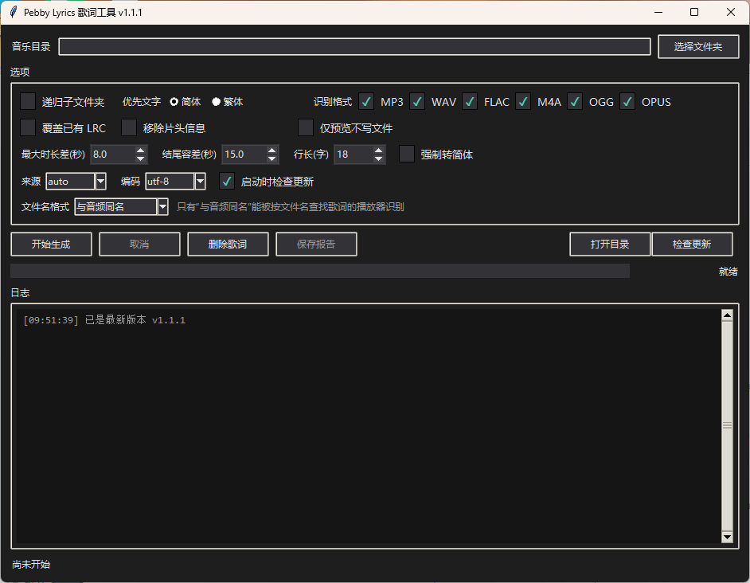
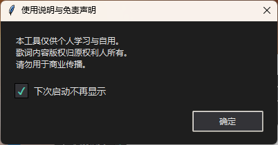
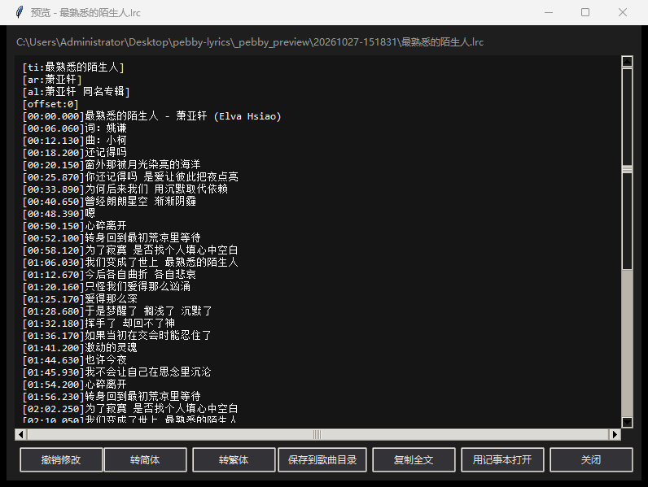

# Pebby Lyrics

给本地音乐批量补齐同名 `.lrc` 歌词的 Windows 小工具：**QQ 音乐优先、LRCLIB 兜底**，不登录、不下载音频、不改动音乐文件本身。



图形界面和命令行共用同一套实现。适合给只认“同目录同名 `.lrc`”侧车歌词的播放器、车机、开发板（比如 [Pebby-Player](https://github.com/ZeroOneLab/Pebby-Player)）准备歌词。

## 特性

| 能力 | 说明 |
|---|---|
| 批量处理 | 递归或只处理当前目录（默认只当前目录），也可只给单个文件；只读标签，不写音频 |
| 双来源择优 | 同专辑 → 简繁优先级 → 来源 → 时长差 → 行长，逐级比较 |
| 简繁处理 | 优先简体/繁体，首选找不到时自动用另一种；“强制转换”把结果统一成优先的那一种（OpenCC 双向） |
| 片头清理 | 可选移除 QQ 歌词开头的“歌名 - 歌手”“词曲/制作”行，默认保留 |
| 长句拆行 | 超过设定字数拆成多条时间轴，适配小屏 |
| 文件名格式 | 默认与音频同名；也可用标签生成“歌名 - 歌手”等命名 |
| 拒绝覆盖 | 已有 `.lrc`（连空文件）一律跳过；写入用排他创建，失败时清理半成品 |
| 试跑预览 | 只查询不落盘；生成完成的歌词也能点击预览，路径按音乐目录相对显示 |
| 编码可选 | UTF-8（默认，无 BOM）或 GBK |
| 自带环境 | 首次运行按提示建 `.lrc-env` 隔离环境，不污染全局 Python |
| 更新提示 | 默认关闭；手动点“检查更新”才联网 |

## 快速开始

### 方式一：下载 EXE（无需 Python）

1. 到 [Releases](../../releases/latest) 下载 `Pebby-Lyrics.exe`
2. 放到**可写目录**（桌面、`D:\Tools` 都行），**不要放 `C:\Program Files`**：单文件版会在 exe 同目录解压临时文件
3. 双击运行，选音乐目录，点“开始生成”

Windows Defender 或 360 偶尔会对 PyInstaller 单文件报“未知程序”，加信任即可；本项目不做任何自解压之外的系统改动。

### 方式二：源码运行

需要 Python 3.10+（Windows x64 上缺 Python 时脚本可代为安装官方版本）：

```powershell
git clone https://github.com/ZeroOneLab/pebby-lyrics.git
cd pebby-lyrics

# 图形界面：首次会说明用途并询问是否安装 Mutagen / OpenCC
.\lrc_gui.cmd

# 命令行：也可以把音乐目录直接拖到 prepare_lrc.cmd 上
.\prepare_lrc.cmd "C:\Users\你\Music"
```

依赖只装在本目录的 `.lrc-env` 里，不修改 PATH、不写全局 site-packages。

## 图形界面

选项按使用顺序排成五行：

1. **识别格式**：MP3 / WAV / FLAC / M4A / OGG / OPUS
2. **优先文字**：简体 / 繁体，后面跟 **强制转换**
3. **开关**：递归子文件夹、覆盖已有 LRC、移除片头信息、仅预览不写文件、启动时检查更新
4. **阈值**：最大时长差(秒)、结尾容差(秒)、行长(字)
5. **来源 / 编码 / 文件名格式**

其余：实时日志（显示相对音乐目录的路径，递归时不会混淆同名文件）、结果统计、保存 JSON 报告、清除日志、批量删除歌词（优先进回收站）。

窗口选项自动保存到 `settings.json`：**默认就在 exe 同目录**（整个文件夹拷到 U 盘也能带着配置走），exe 所在目录不可写时回退到 `%APPDATA%\Pebby-Lyrics\settings.json`。源码运行时保存在脚本目录。

## 首次启动

第一次运行会弹一次使用说明与免责声明：勾选“下次启动不再显示”并点“确定”即可，之后不再打扰（状态存在 `settings.json` 的 `disclaimer` 字段，删掉这个文件会重新弹出）。



## 试跑预览

勾选“仅预览不写文件”后不会生成正式 `.lrc`，而是把结果写进 `_pebby_preview\<时间戳>\`：

- 预览目录**优先放在 exe 旁边**，避免临时文件混进音乐库；exe 目录不可写时再退到音乐目录下
- 日志里每条结果后面有可点击的“预览文件：xxx.lrc（点击预览）”，点开是应用内查看器
- 查看器左下角有 **“保存到歌曲目录”**：觉得这份歌词可以，直接落盘到对应歌曲同目录（覆盖前会确认）；它只是保存，不计入“成功”统计
- 预览内容**可以直接改字**：觉得某句歌词不对，光标点进去改就行，保存的是改完的版本；保存前会检查有没有行不是 `[时间轴]`/`[元数据]` 格式，有就先提醒；点 **“撤销修改”** 回到刚生成的内容
- 同一处还有 **转简体 / 转繁体**：预览时觉得文字形态不合适，可以当场转，再点保存；标题会标出“已转繁体（未保存）”，保存时按预览原来的编码写盘（GBK 存不下会问你是否改用 UTF-8）
- 开始运行时会打印一行“预览文件会写到 …（点击复制路径）”，点一下把路径复制到剪贴板
- **关闭程序时自动删除本次预览目录**（异常退出留下的可以手动删）

不勾预览直接生成时，每条成功的记录后面同样有一行“已生成：xxx.lrc（点击预览）”，可以马上核对生成结果对不对。



命令行等价写法：`--dry-run --preview-dir <目录>`。

## 文件名格式

默认 `same`：`晴天.mp3` → `晴天.lrc`。这是唯一能被“按音频文件名找同目录歌词”的播放器识别的格式。

其余选项用音频标签重命名，适合按文件名显示、或会扫描目录里全部 `.lrc` 的播放器：

| `--name-format` | 输出示例 | 说明 |
|---|---|---|
| `same` | `晴天.lrc` | 默认，侧车约定 |
| `title` | `晴天.lrc` | 用标签歌名，忽略音频原文件名 |
| `title-artist` | `晴天 - 周杰伦.lrc` | 部分车机、旧播放器的习惯 |
| `artist-title` | `周杰伦 - 晴天.lrc` | 同上，顺序相反 |
| `track-title` | `03 晴天.lrc` | 需要 `tracknumber` 标签，缺失时退化为歌名 |

文件名里的 `<>:"/\|?*` 会替换成 `_`，首尾空格和点会被去掉；目标已存在时按“已有文件”跳过，不覆盖。

## 命令行

```powershell
# 处理整个目录，默认 QQ 优先、LRCLIB 兜底
.\prepare_lrc.cmd "C:\Music"

# 先试跑，把预览写到指定目录
.\prepare_lrc.cmd "C:\Music" --dry-run --preview-dir D:\preview

# 优先繁体 / 强制统一成简体 / 调整行长 / 覆盖已有
.\prepare_lrc.cmd "C:\Music" --prefer traditional
.\prepare_lrc.cmd "C:\Music" --convert simplified
.\prepare_lrc.cmd "C:\Music" --max-line-chars 12
.\prepare_lrc.cmd "C:\Music" --overwrite
```

| 参数 | 默认 | 说明 |
|---|---|---|
| `root` | `桌面\音乐` | 音乐目录或单个音频文件 |
| `--source` | `auto` | `auto` / `qq` / `lrclib` |
| `--prefer` | `simplified` | 首选文字形态，找不到时自动用另一种 |
| `--convert` | 关 | 强制转成 `simplified` 或 `traditional`；`--simplify` 是它的旧别名 |
| `--drop-credits` | 关 | 移除 QQ 片头的歌名/词曲行；默认保留 |
| `--name-format` | `same` | `same` / `title` / `title-artist` / `artist-title` / `track-title` |
| `--max-line-chars` | `18` | 长句拆分阈值，`0` 表示不拆 |
| `--overwrite` | 关 | 覆盖同名 `.lrc`；默认跳过且不联网 |
| `--encoding` | `utf-8` | `utf-8` / `gbk` |
| `--dry-run` | 关 | 只查询校验，不写文件 |
| `--preview-dir` | 无 | 配合 `--dry-run` 把预览写到该目录 |
| `--report` | 无 | 输出 UTF-8 JSON 报告（不含歌词正文） |
| `--timeout` | `15` | 单次网络请求超时秒数 |
| `--version` | | 打印版本 |

`python lrc_gui.py --version` / `--check-update` 可在源码模式查版本、查更新；打包后的 EXE 没有控制台，这两个参数以消息框显示。

## 匹配规则

歌名以**标签**为准，但会先做两步清洗，避免因为命名习惯漏掉歌词：

1. 去掉标签里的曲目号前缀：`06.心雨`、`01 - 晴天`、`03、七里香` 都按 `心雨`、`晴天`、`七里香` 搜索和比对；`7 Rings`、`2002年的第一场雪` 这类本身带数字的歌名不受影响。
2. 标签实在对不上（比如标题写成 `Track 01`）时，会在**没有网络错误**的前提下用文件名再试一次，日志里会注明“用文件名…重试后匹配”，最多多一次请求。

## 更新检查与隐私

- **默认关闭**：只有手动点“检查更新”（或自己勾选“启动时检查更新”）才会请求 `api.github.com/repos/ZeroOneLab/pebby-lyrics/releases/latest`
- 勾选后每个自然日最多一次；“跳过此版本”会记住被跳过的版本
- 匿名 API 有 60 次/小时/IP 的配额，被限流时改读 `releases/latest` 的跳转地址取版本号
- 请求只带 `User-Agent: Pebby-Lyrics/<版本>`，没有设备 ID、没有统计、没有遥测
- **不会**自动下载或替换程序，只打开浏览器到发布页

## 常见问题

**提示“没有符合优先级的同步歌词”**
该曲目在 QQ 音乐和 LRCLIB 都没有合格的时间轴歌词，或同名歌曲时长差超过 8 秒。可换 `--source` 单独排查，或手工补歌词。

**报告里 `ambiguous` 是什么意思**
同来源、同文字形态、同时长差评分下存在两份不同歌词，工具不会替你选，需要人工确认。

**“强制转换”到底做什么**
和“优先文字”配合：不勾时只按优先级挑来源、不改文字；勾上时先挑来源，再把结果统一转成优先的那一种（选简体就繁转简，选繁体就简转繁，时间戳不动）。

**QQ 接口会不会失效**
会。它用的是网页内部接口，没有稳定性保证；上游一变动就会失败（此时自动退回 LRCLIB）。这属于预期行为，不是安装问题。

**EXE 双击没反应 / 报找不到临时目录**
确认 exe 放在可写目录，且没有被安全软件拦截。

## 开发

```powershell
# 打包（需要先跑过一次 prepare_lrc.cmd 以建立 .lrc-env）
.\build_lrc_exe.cmd
# 产物：build\output\Pebby-Lyrics.exe

# 单元测试（不联网）
python -m unittest discover -s tests -v
```

发布流程：

1. 改 `version.py` 里的 `__version__`
2. 提交并打 tag：`git tag v1.7.1 && git push origin v1.7.1`
3. GitHub Actions 自动构建并把 `Pebby-Lyrics.exe` 挂到 Release（tag 必须与 `version.py` 一致）

版本历史见 [CHANGELOG.md](CHANGELOG.md)。

## 许可与免责

[MIT](LICENSE) © 2026 零壹实验室

歌词文本版权归原权利人。本工具只读取公开可访问的歌词文本，供个人为自己已拥有的音乐整理播放列表使用；不下载音频、不绕过付费或登录限制、不提供任何资源的破解。
